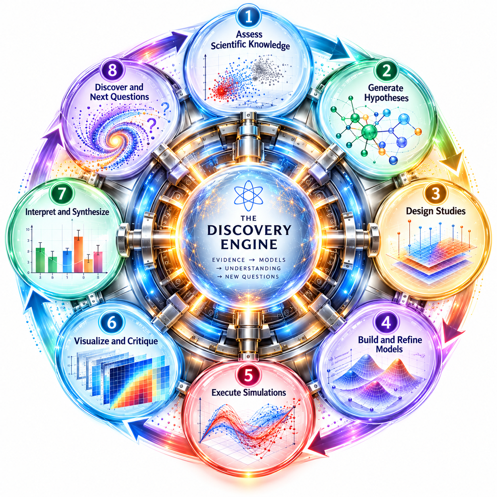

# discovery-engine

<p align="center">
  
</p>

The **investigation/study framework + the derive-first discovery cycle** for the
Vivarium ecosystem. It owns the investigation/study data model, its lifecycle
(canonicalize, contracts, scaffold, seed, migrate, audit), report/card
generation — and the discovery cycle itself: it turns an investigation (an
`investigation.yaml` plus its member `study.yaml` files) into a structured,
reproducible view of what is known, what is unresolved, what is most valuable to
do next, whether a study is materially ready to run, and how to cycle it forward
— and now also **drives that cycle**: reconcile evidence, plan, design
discriminating studies, acquire models, evaluate and promote claims, compose a
transition model, and grow the investigation by seeding and refining studies —
all without performing the science itself.

It is a standalone library, consumed by:

- **[viva-superpowers](https://github.com/vivarium-collective/viva-superpowers)** — the AI-agent skills that drive the engine and the workbench.
- **[vivarium-workbench](https://github.com/vivarium-collective/vivarium-workbench)** — the UI/server for investigations and studies.

## Two layers

The engine has two cooperating layers over the same inputs. See
[`docs/architecture.md`](docs/architecture.md) for the full reference.

**Layer 1 — the pure projection** (assess + gate-readiness + execute + persist):

```
run_cycle        → knowledge / argument / narrative / gates / validators / suggestions
frontier/closure → the prioritized unresolved work + the machine-checkable closure test
opportunities    → value-ranked frontier (info·impact·enable·closure − cost)
run_readiness    → is a study materially ready to produce an evaluable, rendered result?
execute_action   → carry out the next move, gated by consequence
advance_cycle    → build-if-needed and run the open questions
persist_cycle    → the slim regenerable cycle_state + persist-time narrative renewal
```

It is **pure** (no disk I/O) and **derive-first**: every view is computed from
the studies, then merged over any authored override — authored wins, an empty
authored value never clobbers a derived one. Same inputs always yield the same
bundle.

**Layer 2 — the phased discovery cycle** (the generative, evidence-integrity
half). Each phase produces a typed contract and is driven by one CLI verb:

| Phase | What it decides | CLI verb | Module |
|---|---|---|---|
| **A** reconcile | classify each finding's evidence: verified / provisional / contradicted / unsupported | `reconcile-evidence` | `evidence_integrity` |
| **B** plan | one ranked, dependency-ordered portfolio: REPAIR · RESOLVE · EXTEND | `plan` | `candidate_action` |
| **C** design | a discriminating study: contrast, controls, registered predictions, committed decision rule | `design` | `experiment_design` |
| **D** build | capability-driven model acquisition (reuse / wrap / build); immutable `ModelVersion` | `build-model` | `model_architect` |
| **E** execute | run the designed studies, consequence- and autonomy-gated | `advance` / `execute` | (Layer 1) |
| **F** evaluate | promote or reject claims (support × evidence integrity); emit a `DiscoveryDelta` | `evaluate` / `delta` | `evaluation` |

**Growth ops** close the loop — propose → seed → run → promote → refine — gated
by a `human_in_the_loop` (default) vs `autonomous` policy:

| Op | What it does | CLI verb | Module |
|---|---|---|---|
| suggest | propose new studies (followups, narrative gaps, gated decisions) | `suggest` | `discover` |
| seed | author a complete, run-ready `study.yaml` from a parent + proposal/finding | `seed-study` | `study_seeding` |
| refine | deepen an existing study — add seeds, sweep variants, raise model fidelity | `refine-study` | `study_refinement` |

## Install

Use it as a **git dependency** (not published to a package index). In the
Vivarium ecosystem it's wired as a git source in the consumer's `pyproject.toml`,
e.g. in viva-superpowers / vivarium-workbench:

```toml
dependencies = ["discovery-engine", ...]

[tool.uv.sources]
discovery-engine = { git = "https://github.com/vivarium-collective/discovery-engine.git", branch = "main" }
```

Then `uv lock` / `uv sync` resolves it. To work on this repo directly, clone it
and run `uv sync`.

Depends on `viva-emitters` (reads run results) and `viva-workspace` (resolves a
workspace's layout); plus process-bigraph, bigraph-schema, numpy, polars,
ruamel.yaml, pyyaml, click.

## Use — library

```python
import discovery_engine as de

inv = {"studies": ["s1"], "acceptance_criteria": [{"study": "s1", "behavior": "b"}]}
studies = {"s1": {"name": "s1", "behavior_tests": [{"name": "b"}], "runs": []}}

bundle = de.run_cycle(inv, studies)          # pure projection
front  = de.frontier(bundle, inv)            # prioritized unresolved items
clo    = de.closure(bundle, inv)             # {closed, open_items, ...}
opps   = de.opportunities(bundle, inv)       # value-ranked
```

## Use — CLI

Drive a workspace on disk with `discover <verb> <investigation>`.

```bash
# Assess
discover status <inv>                 # project one cycle, print the summary
discover crank <inv>                   # frontier + next action + closure
discover complete <inv>                # the completion map (+ publishable axis)
discover diagnose <inv>                # classify the crank's productivity bottlenecks
discover hypotheses <inv>              # the competing-hypothesis support rollup
discover opportunities <inv>           # value-ranked frontier
discover suggest <inv>                 # new studies to run next

# Cycle N+1 — the phased discovery cycle
discover reconcile-evidence <inv>      # A: evidence integrity per finding
discover plan <inv>                    # B: the CandidateAction portfolio
discover design <inv> <study>          # C: a discriminating study design
discover build-model <inv> --mechanism …   # D: reuse/wrap/build model acquisition
discover evaluate <inv>                # F: claim verdicts (support × integrity)
discover delta <inv>                   # F: the per-cycle DiscoveryDelta

# Cycle N+2

# Grow — propose · seed · refine (autonomy-gated)
discover seed-study <inv> <parent> --slug … [--autonomy …] [--write]
discover refine-study <inv> <study> [--composite …] [--autonomy …] [--write]

# Advance / author
discover advance <inv> [--autonomous]
discover execute <inv> [--execute] [--autonomous] [--ai-decide]
discover set-verdict <study> <verdict> [--rationale …]
discover relate <downstream> <upstream> [--relation …]
discover connect <inv> [--relation …]
discover resolve <inv> <kind> <target> --rationale …

# Maintenance
discover cycle <inv>                   # the full cycle bundle (JSON)
discover snapshot-validations <inv>
```

Every subcommand is self-describing via `discover <verb> -h`.

## Design invariants

- **Progress ⊥ verdict** — a failed execution is not a refuted hypothesis.
- **Closure ⊥ frontier** — a settled argument can still carry non-blocking work.
- **Publishable ⊥ closure** — presentation-completeness is its own axis.
- **Evidence integrity ⊥ support** — whether a claim is backed is distinct from
  whether its evidence is a registered run; a provisional-backed claim is
  provisionally-supported, never promoted.
- **Specify before run** — a discriminating study's predictions and decision
  rule are committed before any run.
- **Declaration ⇒ materialization** — a run is gated unless its composite
  imports, observables are emittable, measures resolve and viz is rendered.
- **Epistemic separation** — a validator's execution status never implies its
  scientific judgment.

## Architecture & roadmap

- **[`docs/architecture.md`](docs/architecture.md)** — the full discovery-cycle
  reference: the two layers, the Phase A–F + N+2 model, the typed contracts
  (Hypothesis, Prediction, Evidence, ExperimentDesign, ModelVersion,
  DiscoveryDelta, CandidateAction), and the propose→seed→run→promote→refine loop.
- **[`docs/roadmap.md`](docs/roadmap.md)** — what has shipped and the remaining
  backlog (EIG over calibrated distributions, figure critique, Bayesian belief
  updates, autonomy budgets + per-decision logs, scientific quality metrics).
